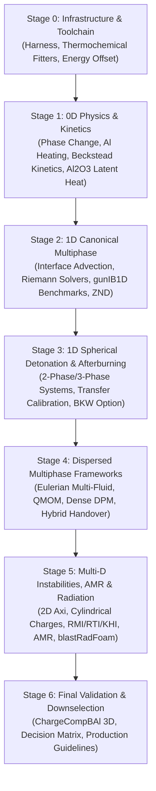

# Master Development Plan: Multiphase Aluminized Detonation & Afterburning Modelling

## 1. Executive Summary & Objective

This master development plan establishes a rigorous, staged program to extend `blastFoam` (OpenFOAM-12) for high-fidelity modelling of aluminized explosive detonation, product expansion, dynamic phase change, aluminium particle dispersion/ignition, and atmospheric afterburning.

- **Ideal Detonation Solver (external)**: The `EuDetCode` C++ library and solver suite is a separate git checkout at `external/eudetcode`, **not tracked by this repository** (neither a submodule nor ignored). The tooling uses its build there: `bin/run_blast_tests.py` Tier 0 (GoogleTest binary `build/tests/eudetcode_tests`; built, 169/169 on 2026-10-13), `tests/1D/verify_planar_znd*.py` (`build/src/DetonationStructure`, `znd_profile.dat`) and `utilities/thermo_fitter/fit_ejwlc_nobleabel.py`. (Until 2026-10-10 these scripts pointed at a non-existent `modules/eudetcode`.) It provides CJ detonation calculations (`CJDetonation`), steady 1D planar ZND / Wood-Kirkwood curved detonation structure (`DetonationStructure`), Hugoniot curves (`HugoniotCurve`), isentropic expansion evaluations, multiple mixture equations of state (THEOSTAR/Exp-6, BKW, JCZ3), and automated JWL fitting with inert phase constraints. It is coupled into the verification and regression toolchains through the paths above.

The plan operationalizes the conceptual roadmap outlined in [`report/plan.txt`](file:///opt/OpenFOAM/blastfoam/report/plan.txt) and builds directly upon the theoretical foundations established in [`report/TBX-blastFoam.tex`](file:///opt/OpenFOAM/blastfoam/report/TBX-blastFoam.tex).



---

## 2. Stage Breakdown & Document Structure

The project is structured into seven dedicated, sequentially executed stages. Each stage is documented in its own detailed action plan. The **Status** column reflects the evidence in the repository on 2026-10-14; see Section 6 and [`status_review_2026-10-14.md`](file:///opt/OpenFOAM/blastfoam/report/status_review_2026-10-14.md) (review against the report aims, with the forward plan).

| Document | Stage Title | Core Focus | Key Deliverables | Status (2026-10-14) |
|---|---|---|---|---|
| [**`stage0_infrastructure_toolchain.md`**](file:///opt/OpenFOAM/blastfoam/report/stage0_infrastructure_toolchain.md) | **Stage 0: Infrastructure & Toolchain** | Automated verification harness, regression testing, `EuDetCode`/`CHEETAH` fitters | Test harness, thermo fitter, EuDetCode coupling | **Partial.** Harness and fitter exist. EuDetCode is a separate checkout (`external/eudetcode`); Tier 0 passes (169/169, 2026-10-13). The case fits were regenerated with the current EuDetCode on 2026-10-13 (D = 7154 m/s, products-only, `utilities/thermo_fitter/products_only_fit.py`). WP 0.3 (BKW/exp-6 tabulation) and the per-step conservation monitor / norms are not implemented. |
| [**`stage1_0d_unit_physics_kinetics.md`**](file:///opt/OpenFOAM/blastfoam/report/stage1_0d_unit_physics_kinetics.md) | **Stage 1: 0D Unit Physics & Kinetics** | 0D reactors, Al thermal ODE, Beckstead combustion, $\text{Al}_2\text{O}_3$ condensation | 0D transfer cases, Al particle kinetics | **Partial.** The 0D transfer tests now run blastEulerFoam (multi-fluid), `phaseTransfer_0D` and `phaseTransfer_0D_3phase` (inert Al): pressure constant to 3e-7 since the 2026-10-13 `E0` recalculation (0.58% before), mass, momentum and total energy conserved (energy to ~5e-9, since the conservative phase decode of 2026-10-12, [`dilute_phase_conservation_plan.md`](file:///opt/OpenFOAM/blastfoam/report/dilute_phase_conservation_plan.md)), with the EuDetCode `T_CJ` and the eJWLC `omegaT` exponent. They meet the WP 1.1 exit criterion $\Delta p/p < 0.01\%$. The isobaric case is missing. Al heating, ignition, Beckstead burning, condensation and high-T air are standalone numpy models (`tests/0D/verify_*.py`), not implemented in C++, with no experimental comparison. WP 1.2–1.5 count as reference models only until they are in the solver. High-T air (WP 1.3), staged: (1) done 2026-10-14, JANAF gas extrapolated with constant $C_p$ above its fit range (no dissociation; shocked air up to 14 400 K spherical, 24 800 K planar); (2) next, NASA-9 polynomials valid to 20 000 K (three temperature ranges) and O2/N2 dissociation chemistry in the gas phase. |
| [**`stage2_1d_canonical_multiphase.md`**](file:///opt/OpenFOAM/blastfoam/report/stage2_1d_canonical_multiphase.md) | **Stage 2: 1D Canonical Multiphase Numerics** | Riemann solvers, interface advection, planar ZND, `gunIB1D` cross-validation | 1D verification cases | **Mostly complete.** All 4 WPs have cases and verifiers (plus `planar_znd_phaseTransfer`). gunIB1D cross-solver comparison passes again with the rebuilt gunIB1D (2026-10-13): Houim 1 0.000%, Houim 2 within 1.20%, Houim 3 peak pressure 0.59%. The planar ZND verifiers need the EuDetCode build in `external/eudetcode`. The compressible drag laws in WP 2.3 (Henderson, Carlson–Hoglund) were not implemented. Since 2026-10-14 the WP 2.1 shock test runs at Mach 14.5 ($T_2 \approx 10\,000$ K): it matches the jump for the solver's non-dissociating air within 1.2% but fails against equilibrium air ($T_2$ 29% high) until dissociation is implemented. |
| [**`stage3_1d_spherical_detonation.md`**](file:///opt/OpenFOAM/blastfoam/report/stage3_1d_spherical_detonation.md) | **Stage 3: 1D Spherical Detonation & Calibration** | Spherically symmetric 2-phase & 3-phase blast, transfer sensitivity, BKW assessment | Radial blast wave profiles, Kingery-Bulmash validation, phase transfer parameter bounds | **In progress.** Done: `temporalMax`/`temporalIntegral` function objects; C4 `spherical_blast` vs Kingery–Bulmash; inert, reacting and Al-combustion `ChargeCompBAl_1D_spherical*` cases (since 2026-10-13 with the products-only fit and α_Al = 0.182, and Al burning only with gas-phase oxidiser). Open: Kingery–Bulmash accuracy (10–20% overpressure error vs the 3% WP 3.1 / 5% Gate 3 targets), the WP 3.2 transfer-sensitivity sweep, long-time 3-phase blast/afterburning runs, WP 3.4 impulse-gain quantification, and the WP 3.5 BKW trial. The products → gas transfer is enabled in `_reacting` and `_alCombustion` since 2026-10-14 (step B1): the products burn with the air. Total energy with a particle phase is conserved since 2026-10-14 (step A6: drag ODE, pressure work on the particle volume, implicit stage): Houim 2 to 6e-7, the spherical cases to 4–7e-4. The cases end at 40 µs in a 0.2 m domain. |
| [**`stage4_dispersed_phase_modelling.md`**](file:///opt/OpenFOAM/blastfoam/report/stage4_dispersed_phase_modelling.md) | **Stage 4: Dispersed Multiphase Frameworks** | Eulerian vs QMOM vs Dense/Dilute Lagrangian vs Hybrid Handover | High-Mach drag laws, QMOM moment transport, $\epsilon_g$ parcel coupling, dynamic handover | **Not started.** (Only upstream `blastEulerFoam` / `blastParcelFoam` exist; `alphaCutoff` drag added in `6f693f7b`.) |
| [**`stage5_multid_instabilities_amr.md`**](file:///opt/OpenFOAM/blastfoam/report/stage5_multid_instabilities_amr.md) | **Stage 5: Multi-D Instabilities, AMR & Radiation** | 2D axisymmetric charges, RMI/RTI/KHI mixing, LES/RANS, AMR, `blastRadFoam` | Cylindrical charge blast asymmetry, turbulent mixing layer growth, AMR parcel filter kernels | **Not started.** (No `blastRadFoam`; the axisymmetric `tutorials/blastEulerFoam/ChargeCompBAl` uses the Stage 3 settings since 2026-10-14; its floating-point exception (116 µs) was a sign error in the residual stabilisation of the upstream fluid phase equations, fixed 2026-10-14; a run restarted from 170 µs then reached 200 µs.) |
| [**`stage6_validation_methodology_downselection.md`**](file:///opt/OpenFOAM/blastfoam/report/stage6_validation_methodology_downselection.md) | **Stage 6: Final Validation & Downselection** | Full 3D `ChargeCompBAl` validation, decision matrix, production guidelines | Validated full-system solver, downselection scoring matrix, user manual additions | **Not started.** |

---

## 3. Core Physics & Numerical Architecture

### 3.1 Thermodynamic Reconciliation Across Phase Boundaries
The simulation transitions from a condensed detonating phase governed by high-pressure Mie-Grüneisen equations of state ([`eJWLC`](file:///opt/OpenFOAM/blastfoam/src/thermodynamicModels/specie/equationOfStates/equationOfStates/eJWLC)) to an expanding reactive multicomponent gas governed by the Noble-Abel co-volume equation of state (named [`AbelNobel`](file:///opt/OpenFOAM/blastfoam/src/thermodynamicModels/specie/equationOfStates/equationOfStates/AbelNobel) in the code). Mass transfer between them is handled by the [`pressurePhaseChange`](file:///opt/OpenFOAM/blastfoam/src/thermodynamicModels/fvModels/pressurePhaseChange) fvModel:

$$\text{eJWLC}: \quad p(\rho, e) = p_s(V) + \omega \rho \left(e - e_s(V)\right)$$

$$\text{Noble-Abel}: \quad p(\rho, T) = \frac{\rho R_{\text{mix}} T}{1 - b_{\text{mix}} \rho}$$

To eliminate artificial pressure and temperature discontinuities at the phase transfer threshold ($p_{\text{trans}} \approx 100\text{--}200\,\text{bar}$), the general four-step matching formulation must be enforced:
1. Continuous transition temperature evaluation: $T_{\text{trans}} = \frac{p_{\text{trans}}(v_{\text{trans}} - b_{\text{mix}})}{R_{\text{mix}}}$.
2. Reference energy offset calculation: $E_0 = e_{\text{sensible, gas}}(T_{\text{trans}}) - e_{s,\text{eJWLC}}(V_{\text{trans}})$.
3. Asymptotic tail calibration ($C^1$ continuity): $\omega_{\text{JWL}} = \gamma_{\text{mix}}(T_{\text{trans}}) - 1$ and $C = p_{\text{trans}} V_{\text{trans}}^{\omega_{\text{JWL}} + 1}$.

*Implementation status:* `pressurePhaseChange` is verified in 0D and planar ZND but is disabled in all Comp-B/Al spherical cases and tutorials (`constant/fvModels.disabled`). The matching is applied offline by the fitter [`utilities/thermo_fitter/fit_ejwlc_nobleabel.py`](file:///opt/OpenFOAM/blastfoam/utilities/thermo_fitter/fit_ejwlc_nobleabel.py), which produces the case coefficients. At run time, `pressurePhaseChange` applies no state-dependent energy correction (only an optional constant `eOffset` datum shift), so the transfer is energy-conservative and pressure continuity relies on the `E0` calibration. Temperature consistency at the transfer state is set through the eJWLC `omegaT` exponent (report Section 3.3.4).

### 3.2 Aluminium Aerodynamics, Ignition & Multi-Oxidizer Combustion
Aluminium particles in the blast environment experience extreme relative Mach numbers ($\text{Ma}_p > 1$), requiring compressible drag models (Henderson / Carlson-Hoglund) spanning continuum and free-molecular regimes:

$$\frac{d\mathbf{u}_p}{dt} = \frac{3}{4} \frac{\rho_g C_{D,\text{comp}}(\text{Re}_p, \text{Ma}_p)}{\rho_p d_p} \|\mathbf{u}_g - \mathbf{u}_p\| (\mathbf{u}_g - \mathbf{u}_p) + \mathbf{g}$$

Thermal evolution incorporates melting latent heat buffering at $T_{\text{melt}} = 933\,\text{K}$ ($\Delta H_{\text{fus}} = 397\,\text{kJ/kg}$) and oxide shell passivation breakdown at $T_{\text{ign}} \approx 2050\text{--}2300\,\text{K}$. Subsequent burning follows a generalized $d^n$ law with multi-oxidizer effective mole fractions:

$$\frac{d(d_p)}{dt} = -\frac{2 K_{\text{comb}}}{\rho_p d_p^{n-1}} \left(X_{\text{O}_2} + 0.6 X_{\text{H}_2\text{O}} + 0.22 X_{\text{CO}_2}\right)^{0.9} \left(1 + 0.276\,\text{Re}_p^{1/2}\text{Sc}^{1/3}\right)$$

Post-combustion condensation of alumina vapour ($\text{Al}_2\text{O}_{3(\text{g})} \to \text{Al}_2\text{O}_{3(\text{s})}$) releases $\sim 19\,\text{MJ/kg}$ of latent enthalpy, maintaining fireball temperatures and driving late-time blast overpressure.

*Implementation status:* none of the Section 3.2 models is implemented in the solvers yet.
- The compressible drag laws, melting latent heat, ignition, $d^n$ burning and alumina condensation exist only in the standalone numpy model [`tests/0D/verify_al_particle_kinetics.py`](file:///opt/OpenFOAM/blastfoam/tests/0D/verify_al_particle_kinetics.py).
- The CFD cases use the existing drag models in `applications/modules/blastEuler/interfacialModels/dragModels/` (none Mach-dependent).
- Particle burning in the CFD cases uses the empirical pressure-based burn rate `src/diameterModels/reactionRates/pressureBased/` ($r_b = a\,p^n$), plus gas-phase Al reactions (`tests/1D_spherical/ChargeCompBAl_1D_spherical_alCombustion`).

---

## 4. Test Case Hierarchy (0D $\to$ 1D $\to$ 2D $\to$ 3D)

Planned hierarchy is shown below. Actual cases (2026-10-14) are mapped in the table that follows it.

```
tests/
├── 0D/
│   ├── phaseTransfer_isochoric/        # Machine Delta p = 0, Delta E = 0
│   ├── phaseTransfer_isobaric/         # Enthalpy and species fraction mapping
│   ├── al_heating_laser_ignition/      # Particle thermal ODE, melting plateau
│   ├── al_combustion_bomb/             # Beckstead constant-V/constant-P bomb
│   ├── highT_air_dissociation/         # NASA-9 polynomials up to 6000 K
│   └── alumina_condensation_box/       # Latent heat coupling & temperature locking
├── 1D/
│   ├── shock_dissociating_air/         # High-Mach shock speed and post-shock T
│   ├── multiphase_contact_advection/   # Non-oscillatory alpha advection
│   ├── riemann_dense_particulate/      # gunIB1D / Lowe & Houim shock tube
│   ├── planar_znd_detonation/          # CJ state and VN spike verification
│   ├── spherical_detonation_2phase/    # JWL + air expansion vs Kingery-Bulmash
│   ├── spherical_detonation_3phase/    # JWL + Al + air inert/reacting comparison
│   └── spherical_detonation_bkw/       # Single-EOS continuous equilibrium trial
├── 2D_Axi/
│   ├── spherical_symmetry_repeat/      # Multi-D symmetry preservation check
│   ├── cylindrical_charge_aspect_ratio/# L/D = 0.5, 1.0, 2.0, 4.0 shock focusing
│   └── turbulent_mixing_layer_rmi_rti/ # Resolved contact discontinuity instabilities
└── 3D/
    ├── ChargeCompBAl_inert/            # Baseline 3D inert Al blast
    └── ChargeCompBAl_reacting/         # Full coupled multi-D production case
```

| Planned | Actual (2026-10-14) |
|---|---|
| `0D/phaseTransfer_isochoric` | `tests/0D/phaseTransfer_0D`, plus `tests/0D/phaseTransfer_0D_3phase` (inert Al); blastEulerFoam since 2026-10-10 |
| `0D/phaseTransfer_isobaric` | Missing |
| `0D/al_heating_laser_ignition`, `al_combustion_bomb`, `alumina_condensation_box` | No solver cases; numpy model `tests/0D/verify_al_particle_kinetics.py` only |
| `0D/highT_air_dissociation` | No solver case; numpy model `tests/0D/verify_highT_air_thermo.py` only |
| `1D/shock_dissociating_air` | `tests/1D/shock_dissociating_air` |
| `1D/multiphase_contact_advection` | `tests/1D/multiphase_advection` |
| `1D/riemann_dense_particulate` | `tests/1D/gunib1d_houim1`, `gunib1d_houim2`, `gunib1d_houim3` |
| `1D/planar_znd_detonation` | `tests/1D/planar_znd`, plus `tests/1D/planar_znd_phaseTransfer` |
| `1D/spherical_detonation_2phase` | Closest: `tests/1D_spherical/spherical_blast` (blastFoam, C4 JWL → air, not Comp-B/Al) |
| `1D/spherical_detonation_3phase` | `tests/1D_spherical/ChargeCompBAl_1D_spherical`, `_reacting`, `_alCombustion`, `_interface` (blastEulerFoam; R = 0.2 m, 40 µs; products → gas transfer disabled) |
| `1D/spherical_detonation_bkw` | Missing |
| `2D_Axi/*`, `3D/*` | Missing (2D-wedge setups exist as tutorials: `tutorials/blastEulerFoam/ChargeCompBAl`, `tutorials/blastFoam/axisymmetricCharge*`) |

The regression runner [`bin/run_blast_tests.py`](file:///opt/OpenFOAM/blastfoam/bin/run_blast_tests.py) defines 18 tests: Tier 0 = 2, Tier 1 = 5 (including both 0D transfer cases), Tier 2 = 6, Tier 3 = 5 (including the stationary charge/air interface). The most recent committed `blast_test_report.md` (`6f693f7b`, 2026-10-05) contains only a Tier 0 run. Since 2026-10-14 the solver-based verifiers fail if the solver log has no `End`.

---

## 5. Risk Management & Decision Gates

| Milestone | Gate Criteria | Fallback Strategy | Status (2026-10-14) |
|---|---|---|---|
| **Gate 1 (End of Stage 1)** | 0D reactor energy and pressure error $< 10^{-6}$; Al ignition delay within 5% of shock tube/bomb data. | Refine $E_0$ offset iteration and calibrate single-particle convective Nusselt correlations. | **Not met.** Energy conserved to ~5e-9 (blastEulerFoam); pressure deviation 3e-7 (target $10^{-6}$; met for both 0D transfer tests since 2026-10-13). Ignition delay has not been compared with experimental data. |
| **Gate 2 (End of Stage 2)** | 1D multiphase Riemann wave speeds and density plateaus match `gunIB1D` reference solutions within 2%. | Switch to AUSM+ or flux-split KT with refined slope limiters (van Leer / Minmod). | **Met (2026-10-13).** With the rebuilt gunIB1D: Houim 1 0.000%; Houim 2 transmitted shock speed 1.20%, post-shock pressure 0.42%, gas velocity 0.67% (solid velocity 2.09%, not part of the check); Houim 3 peak pressure 0.59%. blastEulerFoam Houim 3 compaction speed 183.8 m/s vs 185.25 m/s reference (0.8%) since `alphaDeltaMin` 1e-6. The earlier "within 0.02%" (`0a181853`) compared gunIB1D with the Houim reference, not blastEulerFoam with gunIB1D. |
| **Gate 3 (End of Stage 3)** | 1D spherical blast overpressures match Kingery-Bulmash TNT equivalent within 5% for inert baseline. | Re-tune JWL isentrope fitting range ($V/V_0 \le 20$) and adjust Noble-Abel co-volume $b_{\text{mix}}$. | **Not met.** Peak overpressure error is 10–20% (C4 case, not the Comp-B/Al inert baseline). `tests/1D_spherical/verify_kingery_bulmash.py` passes on looser impulse limits (40% per station, 15% at Z = 2), and its 25% overpressure check is not part of pass/fail. |
| **Gate 4 (End of Stage 4)** | Quantitative scoring of Eulerian, QMOM, Lagrangian, and Hybrid schemes on identical 2D blast clouds. | Downselect the leading method (or Hybrid approach) for all multi-D cases in Stage 5/6. | Not reached. |
| **Gate 5 (End of Stage 6)** | Full 3D `ChargeCompBAl` peak overpressure, arrival time, and positive impulse match experimental gauge data within 8%. | Perform sensitivity analysis on subgrid turbulent mixing timescale $\tau_{\text{mix}}$ in PaSR/EDC. | Not reached. |

---

## 6. Progress Notes

- The stage documents `report/stage*_*.md` were written in `4cb49946` (2026-10-01). Their status sections were corrected on 2026-10-14 for Stages 1 and 2 (WP 1.3 extended); their work-package descriptions are the original plan. Where they disagree with the Status column above, the Status column is current.
- `report/TBX-blastFoam.tex` stage labels, the EuDetCode description and the Stage 1 phase-transfer results were brought in line with this status on 2026-10-10.
- Stage-document paths that do not exist in the code: `src/fvModels/pressurePhaseChange/` (actual: `src/thermodynamicModels/fvModels/pressurePhaseChange/`), `src/combustionModels/blastCombustionModel/`, `src/lagrangian/intermediate/`, `tests/common/`, `src/thermodynamicModels/derived/bkwThermo/`.
- (2026-10-12) The blastEulerFoam phase decode is now conservative: the dilute-phase resets are removed, the granular buoyancy term uses the mixture pressure, and dilute fluid phases are kept near pressure equilibrium by a conservative volume exchange. A stationary charge/air interface test was added (Tier 3). The spherical air shock is now earlier and stronger than with the resets, which deleted the energy of the products expanding into the air. The Stage 3 report numbers and figures were regenerated. Open: pressure relaxation in non-dilute mixed fluid cells, and the gas `residualRho` floor. See [`dilute_phase_conservation_plan.md`](file:///opt/OpenFOAM/blastfoam/report/dilute_phase_conservation_plan.md).
- (2026-10-13) The fluid decode no longer bounds the density below by `residualRho`, which held expanded gas at 1.2 kg/m³: the spherical air shock at 10 cm is now 14 MPa (0.16 GPa with the floor). `alphaDeltaMin` was reduced so the frictional stress limits packing (`houim3` 1e-6, Comp-B/Al cases 1e-3). The reacting-diameter `d0` field is now mapped under AMR (fixes its crash at 2.6e-7 s; the tutorial still fails near 2.7e-4 s with a collapsing time step, as with the original decode). Checked new vs HEAD: `gunib1d_houim1-3`, `validation/blastEulerFoam/shockTube_{dilute,dense,bidisperse}` and `shockTube_polydisperse` run to completion with both.
- (2026-10-13, later) The inert and reacting Comp-B/Al cases and the 1D tutorials relax numerically mixed products/air cells to pressure and temperature equilibrium (`alphaDilute 1` plus a stiff products/gas heat transfer). `_alCombustion` followed on 2026-10-14, after the interface fix.
- (2026-10-13, last) Fits regenerated with the current EuDetCode (D = 7154 m/s, p_CJ = 20.15 GPa; `utilities/thermo_fitter/products_only_fit.py`), with an `E0` on the blastFoam gas energy convention: the 0D transfer is now pressure- and temperature-continuous. The granular Al energy equation now includes the compression (cold) energy and no longer advects kinetic energy into the thermal energy (Al stays at 288 K under compression instead of cooling to 100 K). The instant velocity relaxation and the drag work are energy-conservative. `_interface` passes at 5 µs; beyond it the interface can still become unstable (trace-phase face fluxes, UPDATES.md Section 7).
- (2026-10-14) Charge/air interface instability fixed: in the HLLC flux of a fluid phase that is a trace on one side of a face, that side now takes the mixture impedance (`alphaTrace 1e-3` in the Comp-B/Al cases). `_interface` stays at rest for 40 µs (≤ 1.4 mm/s); the inert, reacting and Al-combustion cases give 16.61 GPa in the charge and 3.3–3.5 GPa at breakout.
- (2026-10-14, later) The blastEulerFoam Comp-B/Al tutorials use the test-case settings (JANAF/Abel–Nobel air instead of ideal-gas air; relaxation settings in the 2D case); the blastFoam Comp-B/Al tutorials were removed. The JANAF gas is extrapolated with constant $C_p$ above its 5000 K fit range (gas `THigh 50000`), which the planar tutorial needs; the spherical air shock is now 47 / 35 MPa at 80 / 100 mm (44 / 29), breakout 3.05 GPa. Next for the gas: NASA-9 thermodynamics to 20 000 K and O2/N2 dissociation chemistry (WP 1.3, see Stage 1 status).
- (2026-10-14, review) Status reviewed against the report aims ([`status_review_2026-10-14.md`](file:///opt/OpenFOAM/blastfoam/report/status_review_2026-10-14.md)): only the detonation and early expansion phase is represented in the solver runs; products/air chemistry, Al ignition/combustion and afterburning are not (transfer disabled, Al models numpy only, 0.2 m / 40 µs domains). The review gives a phased plan (A consolidate, B products → gas transfer, C high-T air, D Al physics in the solver, E 1D validation, F dispersed method, G multi-D, H validation). Phase A started: stage documents corrected (WP 1.2–1.5 marked model-only, Stage 2 results), verifiers check that the solver finished, the `_reacting` verifier checks for heat release. The inert vs reacting U_Al difference (2303 vs 1890 m/s) comes from the drag settings: `_reacting` has `solveDragODE on` and `alphaCutoff 1e-3`, so drag on the dilute Al leading edge is cut off.
- (2026-10-14, report) `TBX-blastFoam.tex` restructured: modelling framework with the multi-fluid equations; provenance of each capability (upstream `blastFoam` at `71b97fd7` vs this work, Table 1 and [upstream]/[this work] marks); separate verification approach and results sections with one test table; status against the aims and the plan. Overstated claims removed (numpy-only models, dissociation, Kingery–Bulmash agreement: peak overpressure 10–21% low, impulse 3–32%); upstream tutorials not assessed in this work moved to an appendix. 21 pages (was 36).
- Per-commit change details: see [`UPDATES.md`](file:///opt/OpenFOAM/blastfoam/UPDATES.md).
