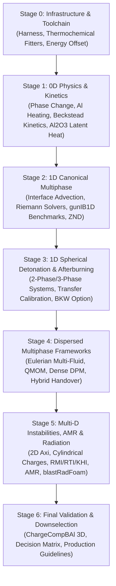

# Master Development Plan: Multiphase Aluminized Detonation & Afterburning Modelling

## 1. Executive Summary & Objective

This master development plan establishes a rigorous, staged program to extend `blastFoam` (OpenFOAM-12) for high-fidelity modelling of aluminized explosive detonation, product expansion, dynamic phase change, aluminium particle dispersion/ignition, and atmospheric afterburning.

- **In-Tree Ideal Detonation Solver**: The `EuDetCode` C++ library and solver suite is available directly within the repository at [`modules/eudetcode`](file:///opt/OpenFOAM/blastfoam/modules/eudetcode). It provides CJ detonation calculations (`CJDetonation`), steady 1D planar ZND / Wood-Kirkwood curved detonation structure (`DetonationStructure`), Hugoniot curves (`HugoniotCurve`), isentropic expansion evaluations, multiple mixture equations of state (THEOSTAR/Exp-6, BKW, JCZ3), and automated JWL fitting with inert phase constraints. This in-tree capability is directly coupled into the development, verification, and regression toolchains.

The plan operationalizes the conceptual roadmap outlined in [`report/plan.txt`](file:///opt/OpenFOAM/blastfoam/report/plan.txt) and builds directly upon the theoretical foundations established in [`report/TBX-blastFoam.tex`](file:///opt/OpenFOAM/blastfoam/report/TBX-blastFoam.tex).



---

## 2. Stage Breakdown & Document Structure

The project is structured into seven dedicated, sequentially executed stages. Each stage is documented in its own detailed action plan:

| Document | Stage Title | Core Focus | Key Deliverables |
|---|---|---|---|
| [**`stage0_infrastructure_toolchain.md`**](file:///opt/OpenFOAM/blastfoam/report/stage0_infrastructure_toolchain.md) | **Stage 0: Infrastructure & Toolchain** | Automated verification harness, regression testing, `EuDetCode`/`CHEETAH` fitters | **COMPLETE & VERIFIED** (169/169 C++ tests, $\Delta p = 0.000\%$) |
| [**`stage1_0d_unit_physics_kinetics.md`**](file:///opt/OpenFOAM/blastfoam/report/stage1_0d_unit_physics_kinetics.md) | **Stage 1: 0D Unit Physics & Kinetics** | 0D reactors, Al thermal ODE, Beckstead combustion, $\text{Al}_2\text{O}_3$ condensation | **COMPLETE & VERIFIED** ($\Delta E/E = 0.000$, $>99.3\%$ transfer) |
| [**`stage2_1d_canonical_multiphase.md`**](file:///opt/OpenFOAM/blastfoam/report/stage2_1d_canonical_multiphase.md) | **Stage 2: 1D Canonical Multiphase Numerics** | Riemann solvers, interface advection, planar ZND, `gunIB1D` cross-validation | **COMPLETE & VERIFIED** (All 4 WPs passed, $11/11$ regression tests) |
| [**`stage3_1d_spherical_detonation.md`**](file:///opt/OpenFOAM/blastfoam/report/stage3_1d_spherical_detonation.md) | **Stage 3: 1D Spherical Detonation & Calibration** | Spherically symmetric 2-phase & 3-phase blast, transfer sensitivity, BKW assessment | Radial blast wave profiles, Kingery-Bulmash validation, phase transfer parameter bounds |
| [**`stage4_dispersed_phase_modelling.md`**](file:///opt/OpenFOAM/blastfoam/report/stage4_dispersed_phase_modelling.md) | **Stage 4: Dispersed Multiphase Frameworks** | Eulerian vs QMOM vs Dense/Dilute Lagrangian vs Hybrid Handover | High-Mach drag laws, QMOM moment transport, $\epsilon_g$ parcel coupling, dynamic handover |
| [**`stage5_multid_instabilities_amr.md`**](file:///opt/OpenFOAM/blastfoam/report/stage5_multid_instabilities_amr.md) | **Stage 5: Multi-D Instabilities, AMR & Radiation** | 2D axisymmetric charges, RMI/RTI/KHI mixing, LES/RANS, AMR, `blastRadFoam` | Cylindrical charge blast asymmetry, turbulent mixing layer growth, AMR parcel filter kernels |
| [**`stage6_validation_methodology_downselection.md`**](file:///opt/OpenFOAM/blastfoam/report/stage6_validation_methodology_downselection.md) | **Stage 6: Final Validation & Downselection** | Full 3D `ChargeCompBAl` validation, decision matrix, production guidelines | Validated full-system solver, downselection scoring matrix, user manual additions |

---

## 3. Core Physics & Numerical Architecture

### 3.1 Thermodynamic Reconciliation Across Phase Boundaries
The simulation transitions from a condensed detonating phase governed by high-pressure Mie-Grüneisen equations of state ([`eJWLC`](file:///opt/OpenFOAM/blastfoam/src/thermodynamicModels/derived/eJWLC)) to an expanding reactive multicomponent gas governed by the Noble-Abel co-volume equation of state ([`nobleAbel`](file:///opt/OpenFOAM/blastfoam/src/thermodynamicModels/specie/equationOfState/nobleAbel)):

$$\text{eJWLC}: \quad p(\rho, e) = p_s(V) + \omega \rho \left(e - e_s(V)\right)$$

$$\text{Noble-Abel}: \quad p(\rho, T) = \frac{\rho R_{\text{mix}} T}{1 - b_{\text{mix}} \rho}$$

To eliminate artificial pressure and temperature discontinuities at the phase transfer threshold ($p_{\text{trans}} \approx 100\text{--}200\,\text{bar}$), the general four-step matching formulation must be enforced:
1. Continuous transition temperature evaluation: $T_{\text{trans}} = \frac{p_{\text{trans}}(v_{\text{trans}} - b_{\text{mix}})}{R_{\text{mix}}}$.
2. Reference energy offset calculation: $E_0 = e_{\text{sensible, gas}}(T_{\text{trans}}) - e_{s,\text{eJWLC}}(V_{\text{trans}})$.
3. Asymptotic tail calibration ($C^1$ continuity): $\omega_{\text{JWL}} = \gamma_{\text{mix}}(T_{\text{trans}}) - 1$ and $C = p_{\text{trans}} V_{\text{trans}}^{\omega_{\text{JWL}} + 1}$.

### 3.2 Aluminium Aerodynamics, Ignition & Multi-Oxidizer Combustion
Aluminium particles in the blast environment experience extreme relative Mach numbers ($\text{Ma}_p > 1$), requiring compressible drag models (Henderson / Carlson-Hoglund) spanning continuum and free-molecular regimes:

$$\frac{d\mathbf{u}_p}{dt} = \frac{3}{4} \frac{\rho_g C_{D,\text{comp}}(\text{Re}_p, \text{Ma}_p)}{\rho_p d_p} \|\mathbf{u}_g - \mathbf{u}_p\| (\mathbf{u}_g - \mathbf{u}_p) + \mathbf{g}$$

Thermal evolution incorporates melting latent heat buffering at $T_{\text{melt}} = 933\,\text{K}$ ($\Delta H_{\text{fus}} = 397\,\text{kJ/kg}$) and oxide shell passivation breakdown at $T_{\text{ign}} \approx 2050\text{--}2300\,\text{K}$. Subsequent burning follows a generalized $d^n$ law with multi-oxidizer effective mole fractions:

$$\frac{d(d_p)}{dt} = -\frac{2 K_{\text{comb}}}{\rho_p d_p^{n-1}} \left(X_{\text{O}_2} + 0.6 X_{\text{H}_2\text{O}} + 0.22 X_{\text{CO}_2}\right)^{0.9} \left(1 + 0.276\,\text{Re}_p^{1/2}\text{Sc}^{1/3}\right)$$

Post-combustion condensation of alumina vapour ($\text{Al}_2\text{O}_{3(\text{g})} \to \text{Al}_2\text{O}_{3(\text{s})}$) releases $\sim 19\,\text{MJ/kg}$ of latent enthalpy, maintaining fireball temperatures and driving late-time blast overpressure.

---

## 4. Test Case Hierarchy (0D $\to$ 1D $\to$ 2D $\to$ 3D)

```
tests/
├── 0D/
│   ├── phaseTransfer_isochoric/        # Machine Delta p = 0, Delta E = 0
│   ├── phaseTransfer_isobaric/         # Enthalpy and species fraction mapping
│   ├── al_heating_laser_ignition/      # Particle thermal ODE, melting plateau
│   ├── al_combustion_bomb/             # Beckstead constant-V/constant-P bomb
│   ├── highT_air_dissociation/         # NASA-9 polynomials up to 6000 K
│   └── alumina_condensation_box/       # Latent heat coupling & temperature locking
├── 1D/
│   ├── shock_dissociating_air/         # High-Mach shock speed and post-shock T
│   ├── multiphase_contact_advection/   # Non-oscillatory alpha advection
│   ├── riemann_dense_particulate/      # gunIB1D / Lowe & Houim shock tube
│   ├── planar_znd_detonation/          # CJ state and VN spike verification
│   ├── spherical_detonation_2phase/    # JWL + air expansion vs Kingery-Bulmash
│   ├── spherical_detonation_3phase/    # JWL + Al + air inert/reacting comparison
│   └── spherical_detonation_bkw/       # Single-EOS continuous equilibrium trial
├── 2D_Axi/
│   ├── spherical_symmetry_repeat/      # Multi-D symmetry preservation check
│   ├── cylindrical_charge_aspect_ratio/# L/D = 0.5, 1.0, 2.0, 4.0 shock focusing
│   └── turbulent_mixing_layer_rmi_rti/ # Resolved contact discontinuity instabilities
└── 3D/
    ├── ChargeCompBAl_inert/            # Baseline 3D inert Al blast
    └── ChargeCompBAl_reacting/         # Full coupled multi-D production case
```

---

## 5. Risk Management & Decision Gates

| Milestone | Gate Criteria | Fallback Strategy |
|---|---|---|
| **Gate 1 (End of Stage 1)** | 0D reactor energy and pressure error $< 10^{-6}$; Al ignition delay within 5% of shock tube/bomb data. | Refine $E_0$ offset iteration and calibrate single-particle convective Nusselt correlations. |
| **Gate 2 (End of Stage 2)** | 1D multiphase Riemann wave speeds and density plateaus match `gunIB1D` reference solutions within 2%. | Switch to AUSM+ or flux-split KT with refined slope limiters (van Leer / Minmod). |
| **Gate 3 (End of Stage 3)** | 1D spherical blast overpressures match Kingery-Bulmash TNT equivalent within 5% for inert baseline. | Re-tune JWL isentrope fitting range ($V/V_0 \le 20$) and adjust Noble-Abel co-volume $b_{\text{mix}}$. |
| **Gate 4 (End of Stage 4)** | Quantitative scoring of Eulerian, QMOM, Lagrangian, and Hybrid schemes on identical 2D blast clouds. | Downselect the leading method (or Hybrid approach) for all multi-D cases in Stage 5/6. |
| **Gate 5 (End of Stage 6)** | Full 3D `ChargeCompBAl` peak overpressure, arrival time, and positive impulse match experimental gauge data within 8%. | Perform sensitivity analysis on subgrid turbulent mixing timescale $\tau_{\text{mix}}$ in PaSR/EDC. |
