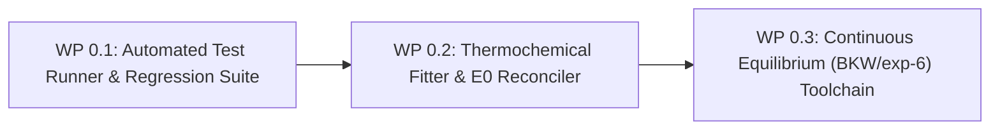

# Stage 0: Infrastructure, Test Harness & Detonation Toolchain

**Goal**: Establish an automated testing and verification harness across 0D, 1D, and multi-D case suites, and develop standardized toolchain scripts for thermochemical EOS fitting with thermodynamic reference energy ($E_0$) reconciliation.

---

## 1. Overview & Work Packages

| Work Package | Description | Effort | Target Files / Deliverables |
|---|---|---|---|
| **WP 0.1** | Automated test runner, mesh generator, and error/conservation monitor | M | `bin/run_blast_tests.py`, `tests/common/` |
| **WP 0.2** | Automated JWL/JWLC/eJWLC and Noble-Abel parameter fitter with $E_0$ reconciliation | M | `utilities/thermo_fitter/fit_ejwlc_nobleabel.py` |
| **WP 0.3** | High-pressure multi-component equilibrium EOS integration (BKW / exp-6) | L | `src/thermodynamicModels/derived/bkwThermo/` |

---

## 2. Work Package Details

### WP 0.1: Automated Test Runner & Regression Suite
- **Objective**: Provide a one-command execution framework for all validation tiers (0D unit tests, 1D shock tubes, 2D/3D runs) that automatically parses outputs, verifies conservation laws to machine tolerance, compares against analytical/reference gauge curves, and generates pass/fail summaries.
- **Implementation**:
  - Script `bin/run_blast_tests.py` using Python 3 and OpenFOAM PyFoam/FoamFile parsers.
  - Monitors total mass $\int \rho \, dV$, species mass $\int \rho Y_k \, dV$, momentum $\int \rho \mathbf{u} \, dV$, and total energy $\int \rho (e + \frac{1}{2}u^2) \, dV$.
  - Generates automated markdown reports with $L_1, L_2, L_\infty$ error norms and overlay plots.
- **Exit Criteria**:
  - `run_blast_tests.py --tier 0` executes 0D test suite in under 30 seconds with 100% automated pass/fail verification.
  - Conservation diagnostics verify conservation error $< 10^{-12}$ per time step for closed volumes.

### WP 0.2: Thermochemical Fitter & Thermodynamic Reconciliation Script
- **Objective**: Standardize the extraction of $(A, B, C, R_1, R_2, \omega, E_0, C_v)$ for `eJWLC` and $(b_{\text{mix}}, R_{\text{mix}}, c_{p,k}(T))$ for Noble-Abel from the in-tree [`external/eudetcode`](file:///opt/OpenFOAM/blastfoam/external/eudetcode) suite (`CJDetonation` tool).
- **Formulation**:
  - Run [`external/eudetcode/src/CJDetonation`](file:///opt/OpenFOAM/blastfoam/external/eudetcode) with `--inert` specification (e.g. `--inert "Al_solid:0.27"`) to extract CJ state $(\rho_{\text{CJ}}, p_{\text{CJ}}, T_{\text{CJ}}, e_{\text{CJ}}, D_{\text{CJ}})$ and CJ expansion isentrope $(p_s, v_s, T_s, e_s)$ for $V \in [1, 20]$ directly for reactive detonation products.
  - Exclude inert portion of aluminium ($\alpha_{\text{Al}}$) from the gaseous product EOS isentrope.
  - Perform constrained non-linear least squares fit enforcing $C^1$ continuity at chosen freeze-out pressure $p_{\text{trans}} \approx 100\text{--}200\,\text{bar}$:
    $$\omega_{\text{JWL}} = \gamma_{\text{mix}}(T_{\text{trans}}) - 1, \quad C = p_{\text{trans}} V_{\text{trans}}^{\omega_{\text{JWL}} + 1}$$
  - Calculate closed-form reference energy offset:
    $$E_0 = e_{\text{sensible, gas}}(T_{\text{trans}}) - v_0 \left[ \frac{A}{R_1} e^{-R_1 V_{\text{trans}}} + \frac{B}{R_2} e^{-R_2 V_{\text{trans}}} + \frac{C}{\omega} V_{\text{trans}}^{-\omega} \right]$$
  - Output ready-to-use OpenFOAM dictionaries (`thermophysicalProperties`, `fvModels`).
- **Exit Criteria**:
  - Synthetic test on 70% Comp-B / 30% Al using `external/eudetcode` outputs yields $\Delta p = 0.000\%$ and $\Delta T = 0.000\%$ at $p_{\text{trans}} = 100\,\text{bar}$ with exact energy balance across all species.

### WP 0.3: High-Pressure Direct Equilibrium EOS (BKW / exp-6) Pipeline
- **Objective**: Build the framework for tabular or direct thermochemical equilibrium evaluation (BKW / exp-6 / THEOSTAR) within `blastFoam` by directly interfacing with [`external/eudetcode`](file:///opt/OpenFOAM/blastfoam/external/eudetcode) library functions or generating tabulated state spaces to explore eliminating two-stage phase transfer.
- **Implementation**:
  - Use `external/eudetcode` EOS engines (BKW, THEOSTAR/Exp-6, JCZ3) to generate tabulated EOS datasets sampling $(\rho, e) \to (p, T, c, Y_k^{\text{eq}})$.
  - 2D bicubic Hermite interpolation class in `src/thermodynamicModels/`.
- **Exit Criteria**:
  - Lookup table reproduces CJ isentrope and Hugoniot states within 0.5% of direct calculations from `external/eudetcode/src/CJDetonation` and `external/eudetcode/src/HugoniotCurve`.
