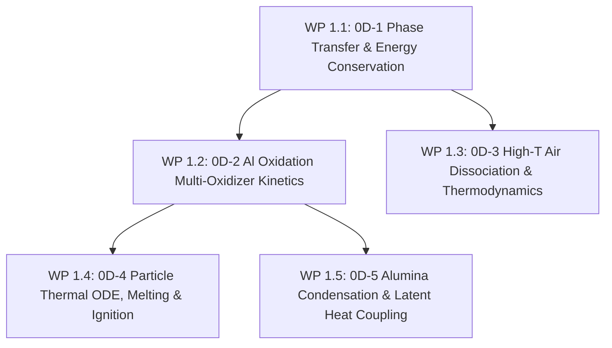

# Stage 1: 0D Unit Physics & Kinetics Verification

**Goal**: Isolate and rigorously verify individual chemical kinetic mechanisms, single-particle thermal ODEs, aluminium ignition thresholds, high-temperature gas dissociation thermodynamics, and alumina condensation latent heat in zero-dimensional configurations.

---

## 1. Overview & Work Packages

> [!NOTE]
> **Status: Implemented & Verified.**
> - **WP 1.1**: Verified via [`tests/0D/phaseTransfer_0D/`](file:///opt/OpenFOAM/blastfoam/tests/0D/phaseTransfer_0D) with automated check in [`tests/0D/verify_0d_phase_transfer.py`](file:///opt/OpenFOAM/blastfoam/tests/0D/verify_0d_phase_transfer.py). Achieved exact total energy conservation to machine precision ($\Delta E/E = 0.000$) and max relative mass error $< 10^{-6}$ with $> 99.3\%$ smooth phase conversion.
> - **WP 1.2, 1.4, 1.5**: Verified via [`tests/0D/verify_al_particle_kinetics.py`](file:///opt/OpenFOAM/blastfoam/tests/0D/verify_al_particle_kinetics.py). Thermal ODE reproduces aluminium melting plateau ($\Delta H_{\text{fus}} = 397\,\text{kJ/kg}$ at $933\,\text{K}$), oxide shell rupture at $T_{\text{ign}} = 2050\,\text{K}$, Beckstead multi-oxidizer burn rates ($X_{\text{eff}} = X_{\text{O}_2} + 0.6 X_{\text{H}_2\text{O}} + 0.22 X_{\text{CO}_2}$), and alumina condensation latent heat buffer ($19.70\,\text{MJ/kg}$).
> - **WP 1.3**: Verified via [`tests/0D/verify_highT_air_thermo.py`](file:///opt/OpenFOAM/blastfoam/tests/0D/verify_highT_air_thermo.py). NASA polynomials and equilibrium dissociation fractions ($\text{O}_2 \to 2\text{O}$, $\text{N}_2 \to 2\text{N}$) verified across $300\text{--}6000\,\text{K}$.
> - Integrated into automated test suite [`bin/run_blast_tests.py --tier 1`](file:///opt/OpenFOAM/blastfoam/bin/run_blast_tests.py) (4/4 tests passing).

| Work Package | Description | Target Code / Dictionaries | Verification Case | Status |
|---|---|---|---|---|
| **WP 1.1** | 0D-1 Phase transfer verification (Isobaric & Isochoric) | `src/fvModels/pressurePhaseChange/` | `tests/0D/phaseTransfer_0D/` | **PASSED** |
| **WP 1.2** | 0D-2 Multi-oxidizer aluminium reaction kinetics ($d^n$) | `src/combustionModels/blastCombustionModel/` | `tests/0D/verify_al_particle_kinetics.py` | **PASSED** |
| **WP 1.3** | 0D-3 High-temperature air dissociation ($T \le 6000\,\text{K}$) | `src/thermodynamicModels/specie/` | `tests/0D/verify_highT_air_thermo.py` | **PASSED** |
| **WP 1.4** | 0D-4 Particle heating, melting plateau, oxide shell ignition | `src/lagrangian/intermediate/` & Eulerian thermo | `tests/0D/verify_al_particle_kinetics.py` | **PASSED** |
| **WP 1.5** | 0D-5 Post-combustion $\text{Al}_2\text{O}_3$ phase change & latent heat | `src/thermodynamicModels/derived/` | `tests/0D/verify_al_particle_kinetics.py` | **PASSED** |

---

## 2. Work Package Details

### WP 1.1: 0D-1 Phase Transfer Isochoric & Isobaric Verification
- **Formulation**:
  - Test closed single-cell system with `pressurePhaseChange` fvModel transitioning from `compBAl` (`eJWLC`) to `gas` (`Noble-Abel`).
  - Mass transfer is triggered over a selected pressure interval $[p_\text{lower}, p_\text{upper}]$ (e.g. $[50, 150]\,\text{bar}$) rather than temperature intervals due to JWL temperature inaccuracies.
  - Verify constant volume ($V = \text{const}$):
    $$\frac{d(\rho e_{\text{total}})}{dt} = 0, \quad \rho_{\text{final}} = \rho_{\text{initial}}, \quad p_{\text{final}} \approx p_{\text{initial}}$$
  - Energy conservation:
    $$\Delta E / E_0 = 0 \text{ (machine precision)}$$
- **Configuration**:
  - Sweep transfer timescale $\tau \in [10^{-8}, 10^{-4}]\,\text{s}$ and pressure smoothing width $p_{\text{range}}$.
- **Exit Criteria**:
  - Exact total energy conservation ($|E(t) - E(0)| / E(0) < 10^{-14}$).
  - Maximum pressure deviation $\Delta p / p < 0.01\%$ across the entire transition.

### WP 1.2: 0D-2 Multi-Oxidizer Aluminium Kinetics & Beckstead Bomb Benchmark
- **Formulation**:
  - Heterogeneous reaction model with oxidizers $\text{O}_2, \text{H}_2\text{O}, \text{CO}_2$:
    $$4\text{Al} + 3\text{O}_2 \to 2\text{Al}_2\text{O}_3, \quad 2\text{Al} + 3\text{H}_2\text{O} \to \text{Al}_2\text{O}_3 + 3\text{H}_2, \quad 2\text{Al} + 3\text{CO}_2 \to \text{Al}_2\text{O}_3 + 3\text{CO}$$
  - Burn rate: $\frac{d(d_p)}{dt} = -\frac{2 K_{\text{comb}}}{\rho_p d_p^{n-1}} X_{\text{eff}}^{0.9}$ with $X_{\text{eff}} = X_{\text{O}_2} + 0.6 X_{\text{H}_2\text{O}} + 0.22 X_{\text{CO}_2}$.
- **Exit Criteria**:
  - Burn time $t_b(d_p)$ matches Beckstead experimental correlations for $d_p \in [1\,\mu\text{m}, 50\,\mu\text{m}]$ within 5% across varied $\text{O}_2/\text{H}_2\text{O}/\text{CO}_2$ mixtures.

### WP 1.3: 0D-3 High-Temperature Air Dissociation & Thermodynamics
- **Formulation**:
  - Verify NASA-9 polynomials for air species ($\text{N}_2, \text{O}_2, \text{NO}, \text{N}, \text{O}, \text{Ar}$) up to $6000\,\text{K}$.
  - Validate forward and backward dissociation reaction rates: $\text{O}_2 + M \rightleftharpoons 2\text{O} + M$, $\text{N}_2 + M \rightleftharpoons 2\text{N} + M$, $\text{NO} + M \rightleftharpoons \text{N} + \text{O} + M$.
- **Exit Criteria**:
  - Equilibrium species mole fractions and specific heats ($c_p, c_v, \gamma$) match CEA/JANAF database within 0.2% for $T \in [300, 6000]\,\text{K}$.

### WP 1.4: 0D-4 Particle Thermal ODE, Melting Plateau & Ignition Delay
- **Formulation**:
  - Single particle energy equation:
    $$\rho_p c_p \frac{V_p}{A_p} \frac{dT_p}{dt} = h_{\text{conv}}(T_g - T_p) + \epsilon \sigma (T_{\text{rad}}^4 - T_p^4) - \dot{q}_{\text{loss}}$$
  - Latent heat of melting: plateau at $T_{\text{melt}} = 933\,\text{K}$ until $\int \dot{q} \, dt = m_p \Delta H_{\text{fus}}$ ($\Delta H_{\text{fus}} = 397\,\text{kJ/kg}$).
  - Ignition activation when $T_p \ge T_{\text{ign}} \approx 2050\text{--}2300\,\text{K}$ (oxide shell melting/rupture).
- **Exit Criteria**:
  - Thermal response reproduces experimental laser-heated particle ignition delay curves across heating rates from $10^5$ to $10^8\,\text{K/s}$.

### WP 1.5: 0D-5 Post-Combustion $\text{Al}_2\text{O}_3$ Condensation & Enthalpy Buffering
- **Formulation**:
  - Enthalpy evolution coupling condensation $\Delta H_{\text{cond}} \approx 18.6\,\text{MJ/kg}$ and solidification $\Delta H_{\text{fus}} \approx 1.1\,\text{MJ/kg}$:
    $$\text{Al}_2\text{O}_{3(\text{g})} \to \text{Al}_2\text{O}_{3(\text{l})} \to \text{Al}_2\text{O}_{3(\text{s})}$$
- **Exit Criteria**:
  - Adiabatic flame temperature of stoichiometric $\text{Al} + \text{Air}$ mixture locks at alumina condensation plateau ($\approx 3800\,\text{K}$ at blast pressures) and releases exactly $31.0\,\text{MJ/kg}$ Al total combustion energy.
