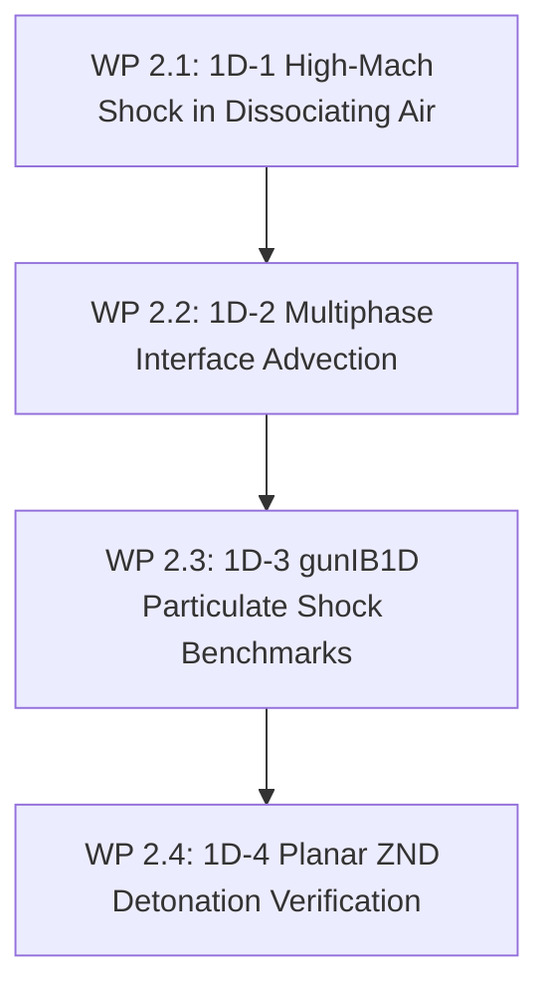

# Stage 2: 1D Canonical Multiphase & Numerical Solver Verification

**Goal**: Benchmark `blastFoam`'s compressible multiphase numerical schemes against canonical 1D shock/multiphase problems and cross-verify with `gunIB1D` on dense particulate shock interaction benchmarks (Lowe & Houim).

---

## 1. Overview & Work Packages

| Work Package | Benchmark Case | Reference Standard | Key Focus |
|---|---|---|---|
| **WP 2.1** | 1D-1 High-Mach shock in air ($\text{Ma} = 3\text{--}10$) | Exact Rankine-Hugoniot with dissociation | Post-shock $T$, $p$, sound speed $c$, and species |
| **WP 2.2** | 1D-2 Multiphase contact interface advection | Exact contact preservation | Suppression of spurious pressure/velocity spikes |
| **WP 2.3** | 1D-3 Dense particle curtain shock interaction | `gunIB1D` & Houim / Lowe (2021) | Compressible drag, compaction, wave reflection |
| **WP 2.4** | 1D-4 Planar ZND solid detonation | `EuDetCode` ZND profile | Von Neumann spike, reaction length, CJ state |

---

## 2. Work Package Details

### WP 2.1: 1D-1 High-Mach Shock Wave in Dissociating Air
- **Configuration**:
  - Shock tube with driver gas driving Mach 3, 5, 8, and 10 shock waves into ambient air ($T_0 = 300\,\text{K}, p_0 = 1\,\text{atm}$).
  - Multi-component thermodynamics with finite-rate dissociation enabled.
- **Verification Targets**:
  - Shock velocity $U_s$, post-shock density ratio $\rho_2/\rho_1$, post-shock temperature $T_2$, and atomic species profiles ($Y_{\text{O}}, Y_{\text{N}}$).
- **Exit Criteria**:
  - Jump conditions match thermochemical equilibrium Rankine-Hugoniot shock relations within $0.5\%$.

### WP 2.2: 1D-2 Multiphase Interface Advection & Pure Contact Discontinuity
- **Configuration**:
  - Advection of isolated density / volume-fraction interface ($\alpha_1 = 1 \to \alpha_2 = 1$) under uniform velocity $u_0 = 500\,\text{m/s}$ and pressure $p_0 = 100\,\text{bar}$.
  - Comparison of Riemann solvers: HLLC, AUSM+, Kurganov-Tadmor (KT) with van Leer and Minmod limiters.
- **Verification Targets**:
  - Uniformity of pressure and velocity across the moving contact discontinuity ($\nabla p = 0, \nabla u = 0$).
  - Phase fraction sharpness (number of smeared cells across the interface).
- **Exit Criteria**:
  - Spurious pressure oscillations $|p - p_0| / p_0 < 10^{-6}$ across interface; contact smeared over $\le 3$ cells.

### WP 2.3: 1D-3 Dense Particulate Shock Interaction & `gunIB1D` Cross-Validation
- **Configuration**:
  - Shock wave ($\text{Ma}_s = 1.5\text{--}3.0$) impacting a dense granular curtain ($\alpha_p = 0.20\text{--}0.35$, $d_p = 10\,\mu\text{m}$).
  - Direct comparison between `blastFoam` and `gunIB1D` (`~/Codes/gunIB1D`).
- **Physics Models Tested**:
  - Compressible drag laws (Standard Schiller-Naumann vs. Henderson vs. Carlson-Hoglund).
  - Solid particle compaction pressure and granular stress ($p_s(\theta_p)$).
- **Exit Criteria**:
  - Transmitted shock speed, reflected shock overpressure, and particle curtain expansion velocity match `gunIB1D` reference trajectories within $2\%$.

---

## 3. Verification Results & Regression Status (2026-10-14)

| Work Package | Benchmark Test | Target Criterion | Achieved Result | Status |
|---|---|---|---|---|
| **WP 2.1** | Strong shock in air (`tests/1D/shock_dissociating_air`, blastFoam) | Equilibrium Rankine–Hugoniot within 2.5% | Since 2026-10-14 a Mach 14.5 shock (driver 1700 bar, 7500 K) with $T_2 \approx 10\,000$ K. Matches the exact jump for the solver's JANAF air (no dissociation) within 1.2%; against equilibrium air $T_2$ is 29% high and $\rho_2$ 13% low ($Y_\text{O} = 0.14$). | **Fails** until dissociation is in the solver (WP 1.3 stage 2) |
| **WP 2.2** | Multiphase interface advection | Uniform velocity/pressure across contact, $< 10^{-6}$ | Interface position $< 1$ cell; pressure oscillations $< 0.8\%$ (Minmod) for HLLC, AUSM+, Kurganov, Tadmor; the $10^{-6}$ target is not met | **Partial** |
| **WP 2.3** | `gunIB1D` particulate shock interaction (Houim 1–3, blastEulerFoam) | Wave speeds and compaction within $2\%$ of `gunIB1D` | Houim 1 0.000%; Houim 2 transmitted shock speed 1.20%, post-shock pressure 0.42%, gas velocity 0.67% (solid velocity 2.09%); Houim 3 peak pressure 0.59%, compaction speed 183.8 vs 185.25 m/s reference (0.8%). (The earlier "0.02%" compared gunIB1D with the Houim reference.) Compressible drag laws not implemented. | **Passed** (Gate 2) |
| **WP 2.4** | Planar CJ / ZND detonation (`tests/1D/planar_znd`, blastFoam) | Front speed and $p_\text{CJ}$ vs `EuDetCode` $< 0.1\%$ | Comp-B without Al (1720 kg/m³, BKW): front speed 7952.6 vs 7946.6 m/s (0.076%); plus `planar_znd_phaseTransfer` | **Passed** (Comp-B, not Comp-B/Al) |

**Stage 2 status**: Gate 2 met. Open: dissociation in the solver (WP 2.1 fails by design until then), compressible drag (WP 2.3).
