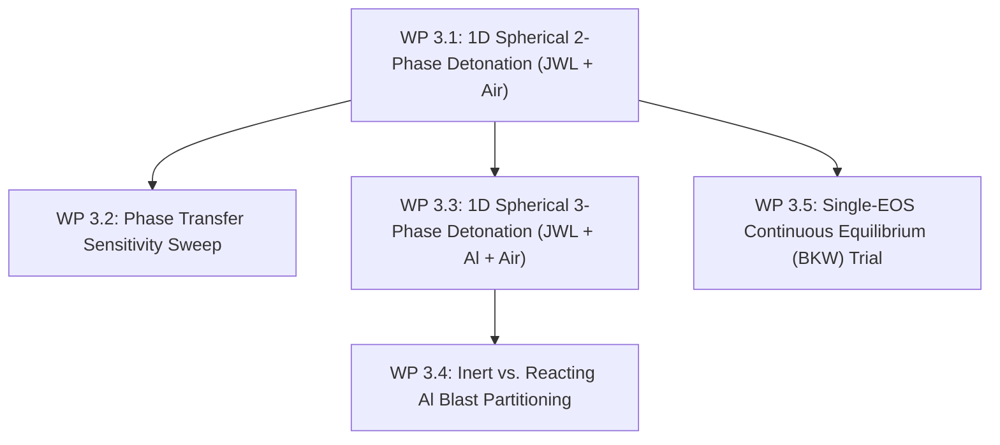

# Stage 3: 1D Spherically Symmetric Detonation & Afterburning Calibration

**Goal**: Model 1D spherically symmetric aluminized explosive detonation and blast expansion into air; systematically calibrate phase transfer triggers and evaluate two-phase (JWL/gas), three-phase (JWL/Al/gas), and single-EOS (BKW) formulations.

---

## 1. Overview & Work Packages

| Work Package | Configuration | Key Objectives | Reference Metrics |
|---|---|---|---|
| **WP 3.1** | 1D Spherical 2-Phase (JWL $\to$ Gas) | Validate spherical blast dynamics and isentropic expansion | Kingery-Bulmash TNT equivalent |
| **WP 3.2** | Phase transfer sensitivity sweep | Calibrate $p_{\text{trans}} \in [50, 500]\,\text{bar}$, $\tau \in [10^{-7}, 10^{-4}]\,\text{s}$ | Gauge pressure & impulse invariance |
| **WP 3.3** | 1D Spherical 3-Phase (JWL + Al + Gas) | Track dynamic inert Al dispersion as distinct phase | Relative phase slip & thermal lag |
| **WP 3.4** | Inert vs. Reacting Al blast partitioning | Quantify afterburning impulse gain from Al oxidation | Experimental positive impulse $I_+$ |
| **WP 3.5** | Continuous equilibrium BKW trial | Test single-EOS approach without two-stage transfer | Numerical cost & transition smoothness |

---

## 2. Work Package Details

### WP 3.1 & WP 3.2: 1D Spherical 2-Phase Blast & Phase Transfer Calibration
- **Geometry & Mesh**:
  - 1D spherical wedge (1-cell thick in $\theta, \phi$), radius $R = 5.0\,\text{m}$, cell count $N_r = 5000$ ($\Delta r = 1\,\text{mm}$).
  - Explosive charge: $R_{\text{charge}} = 0.05\,\text{m}$ ($1\,\text{kg}$ Composition B).
- **Phase Transfer Parametric Matrix**:
  - Threshold pressure: $p_{\text{threshold}} \in \{50, 100, 200, 500\}\,\text{bar}$.
  - Timescale: $\tau \in \{10^{-7}, 10^{-6}, 10^{-5}, 10^{-4}\}\,\text{s}$.
  - Temperature range: $T_{\text{range}} \in \{20, 50, 100\}\,\text{K}$.
- **Exit Criteria**:
  - Gauge pressure-time histories ($p(t)$ at $R = 0.5, 1.0, 2.0, 4.0\,\text{m}$) exhibit $< 1.5\%$ variance across $p_{\text{threshold}} \in [100, 200]\,\text{bar}$.
  - Blast peak overpressure and arrival time match Kingery-Bulmash standard within $3\%$.

### WP 3.3 & WP 3.4: 1D Spherical 3-Phase Detonation & Aluminium Reactivity
- **Configuration**:
  - Phase 1: Detonating condensed HE (`eJWLC`).
  - Phase 2: Granular aluminium ($\alpha_{\text{Al}} = 0.22$, $\rho_{\text{Al}} = 2700\,\text{kg/m}^3$).
  - Phase 3: Ambient air / product gas (`Noble-Abel`).
- **Studies**:
  1. **Inert Baseline**: Al acts purely as momentum/thermal sink (no oxidation).
  2. **Fast Reacting (Nano-Al, $d_p = 100\,\text{nm}$)**: $n = 1.0$, early ignition in expansion wave.
  3. **Standard Micro-Al ($d_p = 15\,\mu\text{m}$)**: $n = 1.9$, ignition delayed until contact with air.
- **Diagnostics**:
  - Overpressure peak $p_{\text{peak}}(R)$, positive impulse $I_+(R) = \int_0^{t_+} (p - p_\infty) dt$, and particle spatial expansion front $r_{\text{Al}}(t)$ vs. gas contact discontinuity $r_{\text{contact}}(t)$.
- **Exit Criteria**:
  - Correct physical separation: $15\,\mu\text{m}$ particles lag initially during CJ acceleration, then cross the decelerating contact surface into surrounding air.
  - Reacting Al demonstrates $25\text{--}40\%$ increase in positive phase impulse over inert baseline.

### WP 3.5: Single-EOS Continuous Equilibrium (BKW / exp-6) Assessment
- **Objective**: Evaluate whether direct thermochemical equilibrium EOS across both products and air (using [`external/eudetcode`](file:///opt/OpenFOAM/blastfoam/external/eudetcode) EOS models: BKW, THEOSTAR/Exp-6, or JCZ3) can replace the two-stage (`eJWLC` $\to$ `Noble-Abel`) transfer.
- **Methodology**:
  - Utilize `external/eudetcode` library routines to compute multi-phase equilibrium states with Al heating along the expansion path.
  - Assess whether switching from instantaneous equilibrium to finite-rate chemistry at a threshold temperature/density is viable without artificial wave reflections.
- **Assessment Criteria**:
  - Computational speed (CPU time per time step).
  - Robustness at extreme expansion ($V/V_0 > 100$) where dense-gas EOS approximations degrade.
- **Decision Outcome**:
  - Formal comparison report deciding whether to adopt BKW / THEOSTAR tables from `external/eudetcode` or retain the calibrated `eJWLC` $\to$ `Noble-Abel` model for Stages 4–6.
