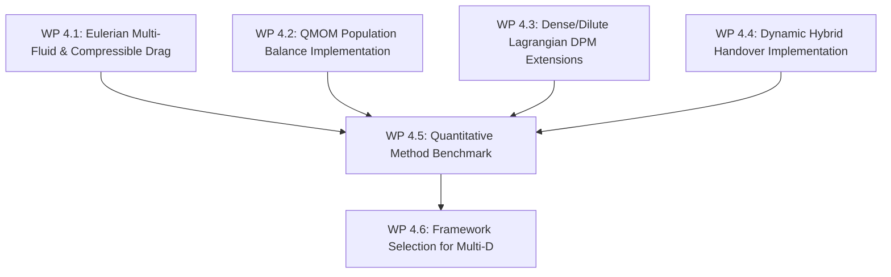

# Stage 4: Dispersed Multiphase Framework Comparison & Selection

**Goal**: Implement, benchmark, and comparatively assess four dispersed multiphase modelling frameworks in blastFoam (Eulerian Multi-Fluid, QMOM Population Balance, Dense/Dilute Lagrangian Parcel Tracking, and Hybrid Eulerian-to-Lagrangian Handover) on expanding particle blast problems.

---

## 1. Overview & Work Packages

| Work Package | Framework | Key Implementation | Target Code Location |
|---|---|---|---|
| **WP 4.1** | Eulerian Multi-Fluid | High-Mach drag (Henderson), compaction pressure | `applications/modules/blastEuler/` |
| **WP 4.2** | QMOM Population Balance | $2N$-moment transport, Wheeler inversion, $d^n$ sink | `src/populationBalanceModels/` |
| **WP 4.3** | Dense/Dilute Lagrangian DPM | $\epsilon_g$ volume coupling, projection filter kernels | `applications/modules/blastParcel/` |
| **WP 4.4** | Hybrid Eulerian-to-Lagrangian | Handover trigger at $\alpha_{\text{Al}} < 10^{-3}$, conservative seeding | `src/fvModels/eulerianToLagrangianTransfer/` |
| **WP 4.5 & 4.6** | Benchmark & Selection | Direct comparative runs on identical blast problems | `tests/multiphase_comparison/` |

---

## 2. Work Package Details

### WP 4.1: Eulerian Multi-Fluid Model Enhancements
- **Formulation**:
  - Solves $\partial_t(\alpha_p \rho_p) + \nabla \cdot (\alpha_p \rho_p \mathbf{u}_p) = -\dot{m}_{\text{comb}}$, coupled with gas volume fraction $\alpha_g = 1 - \alpha_p$.
  - Compressible drag coefficient $C_{D,\text{comp}}(\text{Re}_p, \text{Ma}_p, \text{Kn}_p)$ using Henderson (1976) formulation:
    - Subsonic slip ($\text{Ma}_p \le 1$): acoustic radiation and viscous boundary layer corrections.
    - Supersonic slip ($\text{Ma}_p > 1$): detached bow shock wave drag and post-shock recovery.
  - Granular compaction pressure: $p_p(\alpha_p) = p_0 \left(\frac{\alpha_p}{\alpha_{\text{max}} - \alpha_p}\right)^\beta$ to enforce maximum close packing ($\alpha_{\text{max}} \approx 0.64$).
- **Exit Criteria**:
  - Prevents non-physical particle packing; particle velocity slip in supersonic flow matches shock tube experimental data.

### WP 4.2: QMOM Population Balance Transport
- **Formulation**:
  - Transports statistical moments $m_k = \int_0^\infty d^k n(d) dd$ ($k = 0, \dots, 2N-1$ with $N=3$, representing 6 moments):
    $$\frac{\partial m_k}{\partial t} + \nabla \cdot (m_k \mathbf{u}_p) = \sum_{\alpha=1}^N w_\alpha \, k \, d_\alpha^{k-1} \left(\frac{d(d_p)}{dt}\right)_\alpha$$
  - Dynamic inversion of moments $(m_0, \dots, m_5) \to (w_1, w_2, w_3, d_1, d_2, d_3)$ using the Wheeler algorithm.
- **Exit Criteria**:
  - Accurately tracks evolution of bimodal and Rosin-Rammler size distributions under $d^n$ burning with $< 2\%$ error in mean diameter $d_{10}$ and Sauter mean diameter $d_{32}$.

### WP 4.3: Dense/Dilute Lagrangian DPM Extensions
- **Formulation**:
  - Gas phase momentum equation includes finite volume fraction $\epsilon_g = 1 - \sum \theta_p$:
    $$\frac{\partial (\epsilon_g \rho_g \mathbf{u}_g)}{\partial t} + \nabla \cdot (\epsilon_g \rho_g \mathbf{u}_g \mathbf{u}_g) = -\epsilon_g \nabla p + \nabla \cdot (\epsilon_g \boldsymbol{\tau}_g) + \mathbf{S}_{M,p}$$
  - Parcel volume projection onto Eulerian grid using normalized polynomial smoothing kernels spanning $\ge 3$ grid cells to prevent point-source mesh singularity under AMR.
- **Exit Criteria**:
  - Stable execution under high parcel density without generating artificial acoustic pressure waves at particle cloud edges.

### WP 4.4: Dynamic Hybrid Eulerian-to-Lagrangian Handover
- **Formulation**:
  - In dense core ($\alpha_p \ge \alpha_{\text{crit}} = 10^{-3}$), solve Eulerian continuum.
  - In cells where $\alpha_p < \alpha_{\text{crit}}$, spawn discrete Lagrangian parcels with equivalent mass $m_p = \alpha_p \rho_p V_{\text{cell}}$, momentum, and thermal energy.
  - Decrement Eulerian phase fraction to zero ($\alpha_p \to 0$) in a single conservative step.
- **Exit Criteria**:
  - Exact global conservation of mass, momentum, and total energy during seeding ($|E_{\text{after}} - E_{\text{before}}| / E_{\text{before}} < 10^{-13}$).

### WP 4.5 & 4.6: Comparative Benchmarking & Decision Downselection
- **Benchmark Suite**:
  - 1D and 2D expanding spherical blast with polydisperse Al particles ($d_p \in [1, 50]\,\mu\text{m}$).
- **Evaluation Criteria**:
  1. Particle spatial dispersion and cloud boundary accuracy.
  2. Late-time positive impulse and combustion heat release rate.
  3. Computational execution time (CPU core-hours).
  4. Memory footprint and parallel scaling under AMR.
- **Downselection Deliverable**:
  - Formal scoring report selecting the primary approach (or hybrid model) for all subsequent multi-dimensional work.
