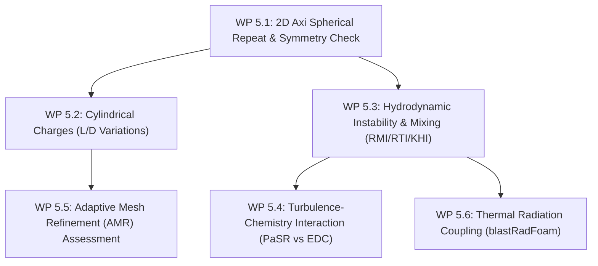

# Stage 5: Multi-Dimensional Simulations, Instabilities, AMR & Radiation

**Goal**: Execute 2D axisymmetric and 3D multi-dimensional simulations to investigate blast asymmetry, hydrodynamic instability-driven turbulent mixing (RMI/RTI/KHI), adaptive mesh refinement (AMR) efficiency, and fireball thermal radiation coupling.

---

## 1. Overview & Work Packages

| Work Package | Focus | Geometry / Physics | Key Output |
|---|---|---|---|
| **WP 5.1** | 2D Axisymmetric Spherical Repeat | Spherical charge in 2D wedge | Symmetry preservation, grid alignment check |
| **WP 5.2** | Cylindrical Charges ($L/D$ variations) | $L/D \in \{0.5, 1.0, 2.0, 4.0\}$ | Directional shock focusing & angular impulse |
| **WP 5.3** | Instabilities & Turbulent Mixing | Resolved contact discontinuity (RMI/RTI/KHI) | Interfacial area growth & mixing rate |
| **WP 5.4** | Turbulence-Chemistry Interaction | PaSR vs EDC vs Arrhenius | Fireball combustion efficiency |
| **WP 5.5** | AMR Optimization | Multi-level octree / 2D quadtree refinement | Scaling & CPU speedup vs fine uniform grid |
| **WP 5.6** | Thermal Radiation Coupling | P1 / fvDOM in `blastRadFoam` | $\text{Al}_2\text{O}_3$ smoke emission & radiative cooling |

---

## 2. Work Package Details

### WP 5.1: 2D Axisymmetric Spherical Repeat & Symmetry Verification
- **Configuration**:
  - 2D axisymmetric wedge ($5^\circ$ wedge or 2D axisymmetric grid) duplicating the 1D spherical charge of Stage 3.
- **Verification Metrics**:
  - Overpressure, impulse, and particle cloud radius plotted at angular positions $\theta \in [0^\circ, 30^\circ, 45^\circ, 60^\circ, 90^\circ]$.
- **Exit Criteria**:
  - Angular variance of shock arrival time and peak pressure $< 0.5\%$; exact overlay on 1D spherical baseline.

### WP 5.2: 2D Axisymmetric Cylindrical Charges & Directional Blast Asymmetry
- **Configuration**:
  - Cylindrical charges of constant mass ($1\,\text{kg}$) with length-to-diameter aspect ratios $L/D \in [0.5, 1.0, 2.0, 4.0]$, initiated at end-point and center.
- **Diagnostics**:
  - Side-on vs. end-on peak overpressure ratio $p_{\text{side}} / p_{\text{end}}$.
  - Asymmetric particle jetting along cylinder axis and lateral expansion.
- **Exit Criteria**:
  - Reproduces directional shock focusing ratios documented in cylindrical blast experiments.

### WP 5.3 & 5.4: Hydrodynamic Instabilities & Turbulent Combustion Closures
- **Physical Mechanisms**:
  1. **Richtmyer-Meshkov (RMI)**: Shock traversal across dense product / light air interface depositing baroclinic vorticity $\nabla \rho \times \nabla p$.
  2. **Rayleigh-Taylor (RTI)**: Deceleration of dense expanding gas/particle core by ambient air.
  3. **Kelvin-Helmholtz (KHI)**: Shear flow along mushroom plume stalks.
- **Turbulence & Combustion Closures**:
  - Compare LES (WALE / Dynamic Smagorinsky) against RANS ($k$-$\omega$ SST with dilatational dissipation).
  - Compare turbulent combustion closures:
    - **PaSR**: $\dot{\omega}_{\text{eff}} = \kappa \dot{\omega}_{\text{chem}}$ with $\kappa = \tau_c / (\tau_c + \tau_{\text{mix}})$.
    - **EDC**: Fine-structure reactor volume fraction $\gamma^* = 2.13 (C_\mu / Re_T)^{1/4}$.
- **Exit Criteria**:
  - LES resolves turbulent roll-up down to grid cutoff, capturing accelerated late-time afterburning; PaSR prevents non-physical subgrid over-reaction.

### WP 5.5: Adaptive Mesh Refinement (AMR) Assessment & Optimization
- **AMR Triggers**:
  - Combined normalized sensor:
    $$\chi = w_p \frac{\|\nabla p\|}{p} + w_\rho \frac{\|\nabla \rho\|}{\rho} + w_\alpha \|\nabla \alpha_{\text{Al}}\| + w_Y \|\nabla Y_{\text{fuel}}\|$$
- **Refinement Strategy**:
  - 2 to 4 refinement levels (effective resolution increase of $4\times$ to $16\times$).
- **Exit Criteria**:
  - AMR captures shock fronts and mixing layers identically to a uniform fine grid while reducing cell count and total runtime by $> 75\%$.

### WP 5.6: Thermal Radiation Coupling with `blastRadFoam`
- **Formulation**:
  - Solve Radiative Transport Equation (RTE) via P1 / fvDOM coupled with energy equation:
    $$-\nabla \cdot \mathbf{q}_{\text{rad}} = \kappa_p \left(4 \pi I_b(T_g) - G\right)$$
  - Planck mean absorption coefficient from sub-micron alumina smoke: $\kappa_p = \frac{3}{2} \frac{\alpha_{\text{smoke}} Q_{\text{abs}}}{d_{\text{smoke}}}$.
- **Exit Criteria**:
  - Quantify fireball radiant heat flux at standoff distances; predict radiative cooling effect on peak blast impulse.
