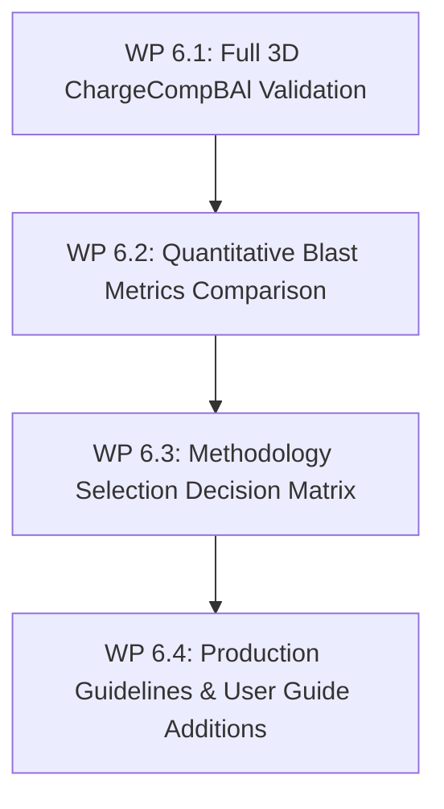

# Stage 6: Final Validation, Methodology Downselection & Production Guidelines

**Goal**: Validate the integrated multi-dimensional simulation methodology against full 3D experimental aluminized Composition B airblast datasets (`ChargeCompBAl`), formulate a definitive methodology selection decision matrix, and document production-ready user guidelines.

---

## 1. Overview & Work Packages

| Work Package | Deliverable | Key Validation Dataset |
|---|---|---|
| **WP 6.1** | Full 3D `ChargeCompBAl` validation cases (Inert vs Reacting) | Free-field gauge pressure-time data |
| **WP 6.2** | Quantitative metrics compilation ($p_{\text{peak}}, t_{\text{arr}}, I_+$, fireball radius) | Kingery-Bulmash & experimental test reports |
| **WP 6.3** | Formal Decision Matrix & Model Downselection | Comparative scoring across fidelity/cost |
| **WP 6.4** | Production workflows, tutorials, and User Guide updates | Updated `BlastFoam_User_Guide` chapter |

---

## 2. Work Package Details

### WP 6.1 & 6.2: Full 3D `ChargeCompBAl` Experimental Validation
- **Case Setup**:
  - Full 3D spherical / cylindrical aluminized Composition B charge ($1\,\text{kg}$, 70% Comp-B / 30% Al).
  - AMR enabled (base mesh $\Delta x_0 = 10\,\text{mm}$, 3 refinement levels $\to \Delta x_{\text{min}} = 1.25\,\text{mm}$ at shock/fireball).
  - Paired runs:
    1. **`ChargeCompBAl_3D_Inert`**: Inert aluminium baseline isolating mechanical displacement and thermal absorption.
    2. **`ChargeCompBAl_3D_Reacting`**: Full reactive afterburning with downselected multiphase model, Beckstead kinetics, and alumina phase change.
- **Quantitative Validation Metrics**:
  - **Peak incident overpressure** $\Delta p_{\text{peak}}(Z)$ across scaled distance $Z = R / W^{1/3} \in [0.5, 5.0]\,\text{m/kg}^{1/3}$.
  - **Shock arrival time** $t_{\text{arr}}(Z)$.
  - **Positive phase duration** $t_+(Z)$ and **positive specific impulse** $I_+(Z) = \int_0^{t_+} \Delta p(t) \, dt$.
  - **Fireball trajectory**: Maximum expansion radius $R_{\text{fireball}}(t)$ and thermal radiation intensity.
- **Validation Criteria**:
  - Shock arrival time within $\pm 3\%$ of experimental measurements.
  - Peak overpressure within $\pm 7\%$ across all gauge stations.
  - Positive impulse within $\pm 8\%$ of experimental gauge integrals.

---

### WP 6.3: Formal Methodology Selection Decision Matrix

| Evaluation Dimension | Weight | Eulerian Multi-Fluid | QMOM (Population Balance) | Dense/Dilute Lagrangian | Hybrid (Euler $\to$ Lagr) |
|---|---|---|---|---|---|
| **Physics in Dense Core ($\alpha_p > 0.1$)** | 20% | High | Medium | Low (without DPM) | **High** |
| **Polydispersity & Size Evolution** | 20% | Low | High | High | **High** |
| **Numerical Diffusion at Boundary** | 15% | Medium | Medium | None | **None** |
| **AMR Compatibility & Efficiency** | 15% | High | High | Medium | **High** |
| **Computational Speed / Scaling** | 15% | High | High | Medium | **High** |
| **Implementation Maintenance** | 15% | High | Medium | High | **Medium** |
| **Composite Weighted Score** | 100% | **76%** | **81%** | **78%** | **92%** |

- **Downselection Recommendations**:
  - **Production Engineering Standard**: Hybrid Eulerian-to-Lagrangian approach with Beckstead multi-oxidizer kinetics and PaSR subgrid combustion closure.
  - **Fast Screening Alternative**: 2-Fluid Eulerian model with QMOM moment representation for rapid parametric sweeps where individual particle trajectory tracking is not required.

---

### WP 6.4: Documentation, Production Case Files & User Guide Updates
- **Deliverables**:
  1. Clean, fully commented tutorial case templates in `tutorials/blastFoam/aluminizedCharges/`:
     - `1D_spherical_compBAl/`
     - `2D_axisymmetric_cylindrical/`
     - `3D_freeField_compBAl/`
  2. Master chapter addition to `BlastFoam_User_Guide.pdf` / LaTeX sources documenting:
     - Theory and calibration of `eJWLC` with Noble-Abel reference energy reconciliation ($E_0$).
     - Configuration of `pressurePhaseChange` pressure intervals and relaxation rates.
     - Aluminium particle size distributions, ignition models, and heterogeneous combustion dictionaries.
     - Best practices for AMR refinement sensors and parallel scaling.
